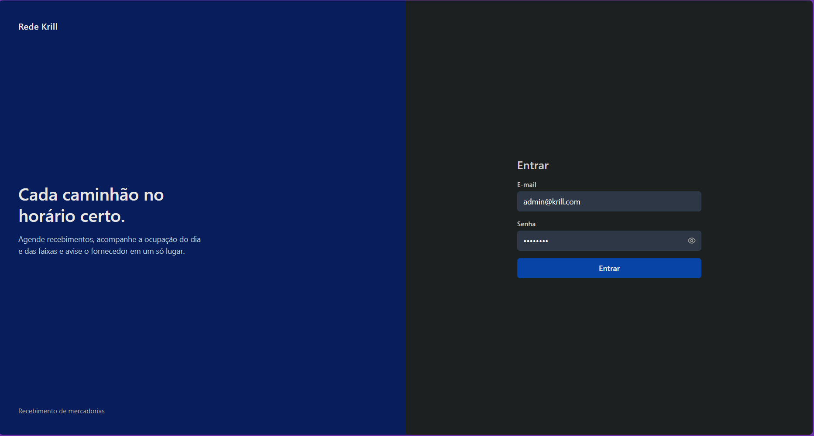

# Agendamento de Recebimento – Teste dev Jr Rede Krill

Aplicação web para cadastrar, consultar, acompanhar e cancelar agendamentos de caminhões, com visibilidade da
ocupação por **dia** e por **faixa horária**. Frontend e backend são separados e conversam **somente por API REST**.

**Autor:** Abimaeel de Menezes Pedro

> Projeto desenvolvido como desafio técnico de processo seletivo. Não é um produto oficial da Rede Krill e não tem vínculo com a empresa; o nome é usado apenas para identificar o desafio.

## Telas do sistema

### Login


## Stack

| Camada | Tecnologia |
|---|---|
| Backend | Java 17, Spring Boot 3.3, Spring Security (JWT), Spring Data JPA, Flyway |
| Frontend | Vue 3 (Vite, Pinia, Vue Router), Tailwind CSS 4, PrimeVue 4 |
| Banco | MySQL 8 |
| API docs | Swagger UI (springdoc-openapi) |
| Testes | JUnit 5, Mockito, AssertJ, JaCoCo (backend); Vitest (frontend) |
| Infra | Docker, docker-compose, nginx |

## Como executar (recomendado: Docker)

Pré-requisito: Docker Desktop (ou Docker Engine + Compose v2).

```bash
git clone <URL-DO-REPOSITORIO>
cd krill-agendamentos
docker compose up --build
```

Quando os quatro serviços estiverem de pé:

| O quê | Endereço |
|---|---|
| Sistema (frontend) | http://localhost:3000 |
| API | http://localhost:8080 |
| Swagger UI | http://localhost:8080/swagger-ui.html |
| Caixa de e-mails de teste (Mailpit) | http://localhost:8025 |
| MySQL (para clientes como DBeaver/Workbench) | `localhost:3307`, banco `krill`, usuário `krill`, senha `krill` |

### Usuários iniciais

| Perfil | E-mail | Senha |
|---|---|---|
| Administrador | `admin@krill.com` | `admin123` |
| Usuário comum | `usuario@krill.com` | `usuario123` |

> Troque as senhas e o `JWT_SECRET` em qualquer ambiente real (variáveis `SEED_*` e `JWT_SECRET`).

Os e-mails de confirmação enviados ao fornecedor aparecem no Mailpit (http://localhost:8025).

## Como executar sem Docker (desenvolvimento)

Pré-requisitos: JDK 17+, Maven 3.9+, Node 20+, MySQL 8 (ou `docker compose up -d db mailpit`).

```bash
# 1) infraestrutura de apoio (banco e caixa de e-mail)
docker compose up -d db mailpit

# 2) backend (http://localhost:8080) - o banco do compose fica na porta 3307 do seu PC
cd backend
# Windows (PowerShell):  $env:DB_PORT="3307"; mvn spring-boot:run
# Linux/Mac:             DB_PORT=3307 mvn spring-boot:run

# 3) frontend (http://localhost:5173, com proxy de /api para o backend)
cd ../frontend
npm install
npm run dev
```

## Testes e cobertura

```bash
# backend: testes + relatório JaCoCo (backend/target/site/jacoco/index.html)
cd backend
mvn clean verify

# frontend
cd frontend
npm install
npm test
```

`mvn verify` falha se a cobertura de linhas ficar abaixo de **80%** nos domínios críticos:
`CapacidadeCalculator`, `AgendamentoService` e `OcupacaoService`.

## Relatório de segurança

```bash
# vulnerabilidades em dependências Java (relatório em backend/target/dependency-check-report.html)
cd backend
mvn org.owasp:dependency-check-maven:check

# vulnerabilidades em dependências do frontend
cd frontend
npm audit
```

Dica: a primeira execução do Dependency-Check baixa a base NVD e pode demorar. Uma chave de API gratuita da NVD
(`-DnvdApiKey=...`) acelera bastante.

## Regras de negócio implementadas

- **480 pallets por dia** e **120 pallets por faixa**: excedê-los **não bloqueia** o cadastro; a API devolve `avisos`
  e a tela exibe a notificação (e uma previsão antes de salvar).
- **4 faixas de 2 horas** (padrão 08–10, 10–12, 13–15, 15–17). O cadastro valida duração de 2h, ausência de
  sobreposição e o máximo de 4 faixas.
- **Paletizado / Não paletizado**: o tipo tem um *fator*; não paletizado usa fator 2, ou seja, **dobra** os pallets
  ocupados na faixa.
- **Tipos de caminhão**: Truck, Carreta e Van (editáveis).
- **Cadastro de agendamento**: data e faixa mostram a ocupação em %; ID do pedido (número), fornecedor e e-mail
  (80 caracteres), tipo de caminhão, tipo de paletização, observação opcional.
- **E-mail** de confirmação enviado ao fornecedor após o cadastro (assíncrono; falha de SMTP não derruba o cadastro).
- **Relatório**: busca de agendamentos por período (e situação).
- **Permissões**: Administrador (cadastra, visualiza, cancela e administra cadastros); Usuário Comum (somente
  visualiza agendamentos e ocupação).
- **Auditoria**: tela exclusiva do administrador com as ações executadas (login, falhas de login, criação,
  alteração, cancelamento, exclusão, consultas e acessos negados).

### Suposições

- O enunciado não lista a **quantidade de pallets** no agendamento, mas ela é necessária para calcular a ocupação;
  por isso o formulário tem o campo "Quantidade de pallets".
- A ocupação considera apenas agendamentos com situação *Agendado* (cancelados liberam a capacidade).
- Datas passadas são aceitas, pois o administrador pode registrar recebimentos já ocorridos.

## Endpoints principais

| Método | Rota | Perfil |
|---|---|---|
| POST | `/api/auth/login` | público |
| GET | `/api/agendamentos?inicio=&fim=&status=` | ADMIN, COMUM |
| POST | `/api/agendamentos` | ADMIN |
| PATCH | `/api/agendamentos/{id}/cancelar` | ADMIN |
| GET | `/api/ocupacao?data=` | ADMIN, COMUM |
| GET/POST/PUT/DELETE | `/api/tipos-caminhao`, `/api/tipos-paletizacao`, `/api/faixas-horarias` | GET: todos · escrita: ADMIN |
| GET/PUT | `/api/configuracao-capacidade` | GET: todos · PUT: ADMIN |
| GET | `/api/auditoria?inicio=&fim=&usuario=` | ADMIN |

A documentação completa e interativa está no Swagger UI (use **Authorize** com o token do login).

## Decisões arquiteturais

**Clean Architecture (pragmática).** O backend é organizado em camadas com dependências apontando para dentro:

```
presentation   → controllers REST, DTOs de entrada/saída, tratamento de erros
application    → casos de uso (AgendamentoService, OcupacaoService, CatalogoService, AuthService…) e portas
domain         → entidades, repositórios, regras puras (CapacidadeCalculator) e exceções
infrastructure → segurança JWT, auditoria (filtro), e-mail SMTP, configuração, seed
```

- As regras de capacidade ficam em `CapacidadeCalculator` (classe pura, sem framework), fáceis de testar.
- O envio de e-mail e a emissão de token são **portas** (`NotificadorEmail`, `TokenProvider`) implementadas na
  infraestrutura, o que permite trocar a implementação e testar os casos de uso com mocks.
- Concessão pragmática: as entidades do domínio carregam anotações JPA e os repositórios são interfaces Spring Data,
  evitando uma camada duplicada de mapeamento num sistema deste tamanho.

**Segurança.** API *stateless* com JWT (HS256), senhas com BCrypt, autorização por perfil no `SecurityFilterChain`,
validação de entrada com Bean Validation, CORS restrito, contêiner do backend sem root. As regras de permissão
são aplicadas no **backend**; o frontend apenas esconde o que o perfil não pode usar.

**Capacidade como aviso, não bloqueio.** `AgendamentoService.criar` calcula a ocupação resultante e devolve avisos
junto com o agendamento salvo. O valor de pallets ocupados é gravado no agendamento (`pallets_consumidos`), então
mudar o fator de paletização depois não reescreve o histórico.

**Auditoria.** Um filtro (`AuditFilter`) registra cada chamada a `/api` com usuário, ação, recurso, status HTTP e IP;
login e falhas de login são registrados no `AuthService`.

## Justificativa do banco de dados: MySQL 8

- Dados naturalmente **relacionais** (agendamento ↔ faixa, caminhão, paletização): o motor **InnoDB** garante
  chaves estrangeiras e integridade referencial.
- Transações **ACID** e agregações eficientes (`sum`/`group by`) para calcular a ocupação por dia e faixa.
- Índice composto `(data, status)` acelera a consulta de ocupação e o relatório por período.
- Banco **muito difundido** no mercado, com grande comunidade, ampla oferta de hospedagem e equipes que já o operam,
  o que reduz o custo de manutenção.
- Excelente suporte no Spring Data JPA e no Flyway, e imagem oficial para Docker, o que simplifica a execução local.
- Esquema versionado com **Flyway** (`backend/src/main/resources/db/migration`), com charset `utf8mb4`
  para acentuação correta.

## Estrutura do repositório

```
krill-agendamentos/
├── backend/            # Spring Boot (Dockerfile multi-stage)
├── frontend/           # Vue 3 + Tailwind + PrimeVue (Dockerfile multi-stage + nginx)
├── docker-compose.yml  # db (MySQL) + mailpit + backend + frontend
└── README.md
```
